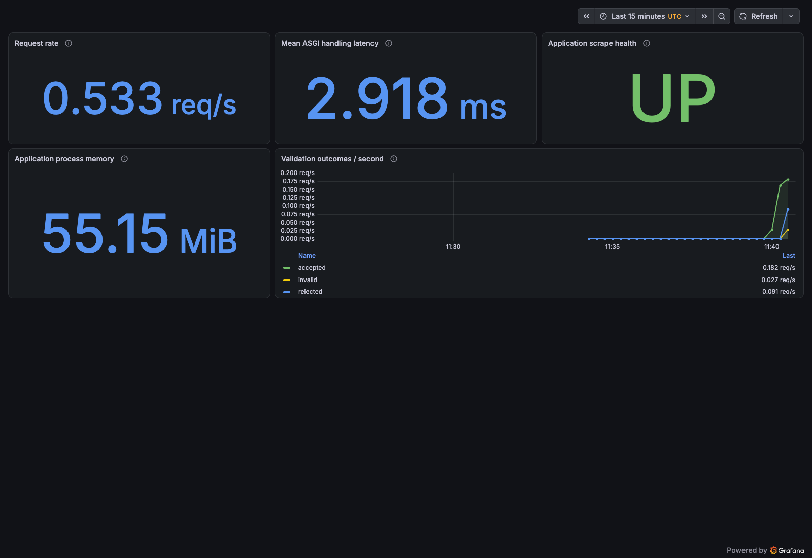

# Step 6.2 — Authenticated local Grafana dashboard

**Later status:** merged/published as `f61cb4f`; normal SCM build #19 verified.
See the [follow-up](step-02-scm-verification.md). The dated candidate record below
preserves the original execution and its then-pending publication status.

**29 October 2026 UTC.** Implementation `7858049` on `task-06/step-02-dashboard`,
based on reviewed/published main `5e53c5f`. **Locally verified; review/merge/publication
and normal SCM proof remain pending.** Application source and its metric contract
are unchanged. The [runbook](../../docs/runbooks/dashboard.md) describes setup and limits.

## Approved credential correction

The original host-file CHOWN failure is preserved in the
[preflight record](step-02-preflight.md). The user approved a dedicated secret volume,
without additional capabilities or password rotation.

The existing host file remained operator-owned UID 501, mode 0400, inside its private
0700 directory. The new purpose-labelled volume `finsecure-monitoring-grafana-secrets`
was initialized through stdin by a network-isolated, read-only-root helper with only
CHOWN added. Inside the Linux volume, the directory is UID/GID 472 mode 0700; the
single-link regular password file is UID/GID 472 mode 0400. Host/volume values matched.
The helper rejects missing, foreign or mismatched state rather than replacing it.

Grafana mounted this volume read-only and used its native file provider. The password
was absent from container configuration, process environment and collected logs.
No value, hash of the password, authentication cookie or private database is stored
in evidence. Helpers were removed; host credential and secret volume were preserved.

[Final runtime/secret boundaries](step-02/recheck/runtime-boundaries.json).

## Checks and exact images

- **578 host tests passed**, including 40 dashboard/credential cases; warnings-as-errors
  execution and report generation passed. Ruff lint/format and wheel/source build passed.
- Source gate: **29 LOW Bandit findings, no MEDIUM/HIGH**. All **15** application runtime
  dependencies audited with no known advisories. No dependency version was changed.
- The optional Compose overlay validated. Provisioning JSON/YAML and metric selectors,
  authentication settings, private-file refusal cases and helper cleanup were tested.
- Application: the exact verified **normal SCM build #18** archive at `5e53c5f` was
  checksum-checked, loaded and tagged locally. Its source/image identity matched the
  gate record. This is not a new image build or a claim that #18 ran the new 578 tests.
- Grafana: official release 13.3.0, immutable multi-platform index
  `sha256:488984b716c0862639f91a698adbe2862677a5a07bad42da5f03f3030883b205`.
  ARM64 availability, UID 472, runtime version and configured boundaries were verified.
  No independent signature check or complete Grafana/monitoring-stack vulnerability
  scan is claimed; the application-specific image gate covers the application archive.

[Final checks](step-02/final-checks.txt),
[completion checks](step-02/completion-checks.txt),
[source/dependency summary](step-02/security-summary.json),
[checked implementation hashes](step-02/checked-source-hashes.json), and
[application image provenance](step-02/application-provenance.json).

## Actual authenticated queries and visible panels

Grafana was started with loopback port 3000, 0.5 CPU/512 MiB, no extra swap, read-only
root, dropped capabilities, no-new-privileges and its own data/secret volumes.
The existing application/Prometheus limits and separate monitoring network remained.

Authenticated API checks verified the provisioned dashboard's exact five expressions,
read-only data source and successful Prometheus data-source health query. Anonymous
protected dashboard/data-source requests returned **401**; dashboard navigation
redirected to login. The public health endpoint returned 200 on loopback, as documented.

Here, traffic means the synthetic `/health` and `/validate` workload; `/metrics`
probes/scrapes and infrastructure health/provisioning checks are separate.
Exactly **60 synthetic requests were sent once**, without traffic retries:
20 health, 20 accepted, 10 rejected and 10 invalid. Prometheus observed exact outcome,
request and histogram deltas. All five Grafana panel queries returned actual numeric
data. No static/demo data source or manually supplied chart values were used.

Existing Chrome 156.0.8078.48 and Node 22.23.2 provided an isolated authenticated
browser capture through a temporary loopback debugger. No new browser dependency or
personal browser profile was used. The screenshot was inspected and shows all five
panels, including visible request rate and latency:

At capture time the display showed **0.533 req/s**, **2.918 ms**, **55.15 MiB**, **UP**,
and three outcome curves. The earlier API query sample recorded about 0.458 req/s;
API queries and the browser evaluated at different times. Both original observations
are retained, not normalized to the generator's send rate. Rolling rates are not a
load benchmark, SLO, transaction settlement count or managed-cluster measurement.

[Access checks](step-02/live/grafana-access.json),
[traffic verification](step-02/live/verification.json),
[Grafana panel query responses](step-02/live/grafana-panel-queries.json),
[query value summary](step-02/live/grafana-panel-values.json),
[actual provisioned dashboard](step-02/live/grafana-provisioned-dashboard.json), and
[browser verification](step-02/live/browser-verification.json).

The browser logged out; a subsequent session request returned 401. Its owned process
and private profile were removed. No screenshot of credentials/login inputs was taken.

## Provisioning mount fix and honest warning record

Log review found two startup errors: the original whole provisioning-directory mount
hid the image's unused `plugins` and `alerting` directories. Individual read-only file
mounts replaced it. A regression assertion checks those exact destinations.

The corrected stack was started and actually rechecked: same five expressions
provisioned, authenticated data-source health OK, and anonymous dashboard API 401.
No further synthetic health/validation requests were generated; metrics probes and
infrastructure checks continued. The restarted application's instrumented request
series were absent and initialized outcome counts were zero. The original screenshot
is evidence of the first successful panel run, not a new traffic run after this fix.

[Corrected startup verification](step-02/recheck/verification.json) and
[corrected startup output](step-02/corrected-start.txt).

Remaining observations are explicitly retained:

- Grafana's default `x_xss_protection` deprecation warning. No security-header change
  or speculative CSP configuration was made merely to remove it.
- Search-manifest discovery warnings (zero manifests). The five required panels and
  direct dashboard queries worked; no broader search-feature correctness is claimed.
- A `context canceled` cleanup-controller ERROR during graceful shutdown, despite
  container exit 0. First-start migration warnings are also retained.
- Native Chrome allocator/display-link diagnostics despite successful rendering and
  capture. No browser stderr suppression was added.
- Prometheus's graceful-stop WARN messages. The first log extract also includes a
  retained prior stop; corrected-run extracts are bounded to the new start time.

[First Grafana log extract](step-02/live/grafana-warnings.txt),
[corrected Grafana log extract](step-02/recheck/grafana-warnings.txt), and
[browser stderr](step-02/live/browser-stderr.txt). Extracts include INFO deprecation
context as well as WARN/ERROR lines. The closed debugger URL was redacted; no warning
line was discarded to present a warning-free run.

## Cleanup and remaining scope

After the corrected verification, **all three monitoring services exited 0**, with
no OOM. Prometheus data, Grafana data, secret volume and the unchanged private host
credential remain. No global prune or volume deletion occurred. Jenkins services were
not stopped/reconfigured; its separate credential-boundary verifier passed.

[Final cleanup](step-02/recheck/cleanup.json),
[stop output](step-02/recheck/stop.txt), and
[Jenkins boundary check](step-02/jenkins-boundaries.txt).

Historical procedures: [query/traffic orchestration](step-02/verify-dashboard.py.txt),
[bounded traffic](step-02/verify-traffic.py.txt),
[browser capture](step-02/browser-capture.mjs.txt),
[first cleanup](step-02/cleanup.py.txt), and
[corrected-run cleanup](step-02/recheck-cleanup.py.txt).
These are records, not permission to rerun traffic or rotate credentials.

No registry publishing, cloud deployment, managed-cluster metrics, alert rules,
notification receiver or centralized logging was introduced. The dashboard is now
stopped, not claimed continuously available. Normal SCM verification of this branch
will follow only after review and approved merge/publication.

All 43 retained procedure/result files have a verified [SHA-256 manifest](step-02/SHA256SUMS).
Evidence was checked against the live Grafana/Jenkins credentials before retention.
[Completion state](step-02/completion-state.json) confirms monitoring stopped and
Jenkins main still at build #18. Documentation paths and implementation hashes were
checked; the final documentation-only changes do not relabel the earlier executions.
