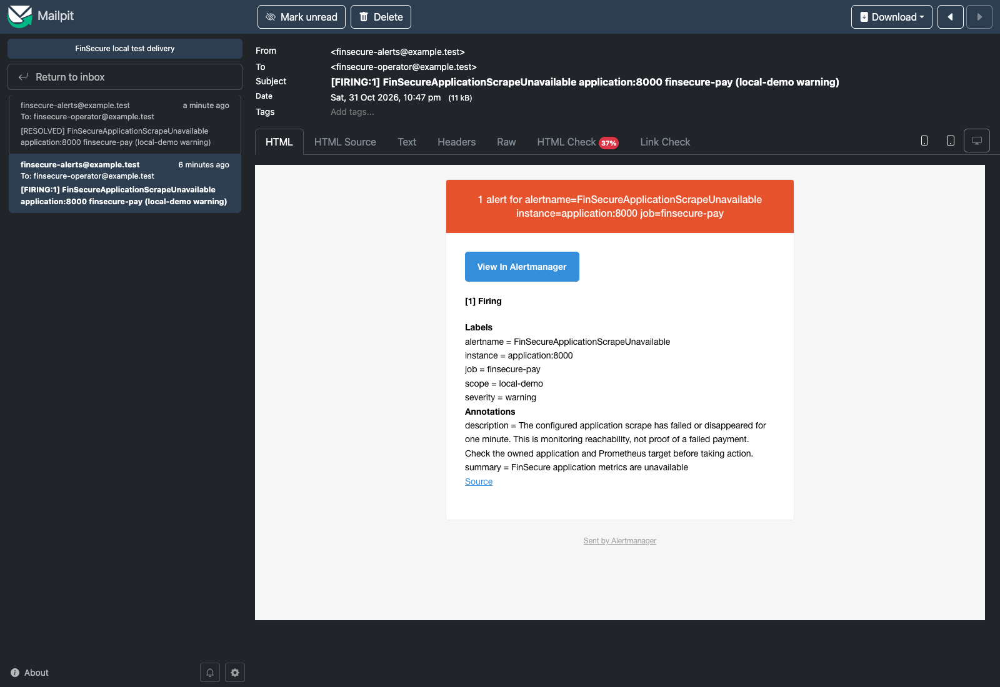
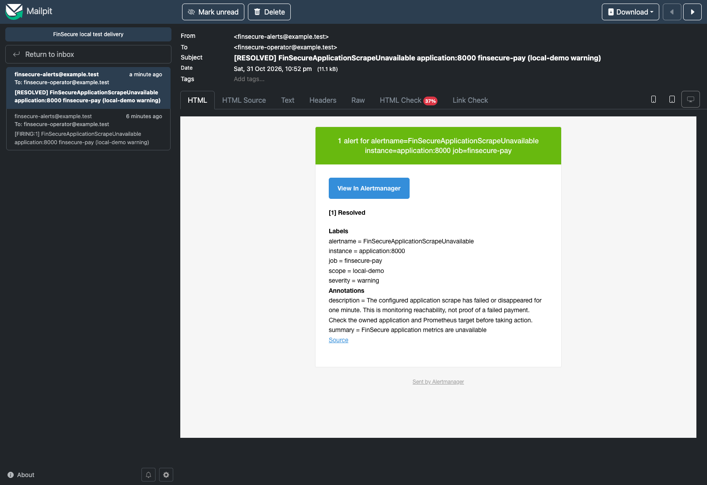

# Step 6.4 — Actual firing and recovery notification receipt

**31 October 2026 UTC.** Dedicated branch `task-06/step-04-alert-demonstration` starts
from reviewed/published `b06aa03`. **Local demonstration complete; review/merge/publication
pending.** Existing alert/routing configuration and application code were unchanged.

## Actual sequence

| Observation | UTC time |
| --- | --- |
| Stop requested for owned application only | 14:45:47.362 |
| Application stop completed | 14:45:48.155 |
| First observed failed scrape (`up=0`) | 14:46:00.277 |
| Pending rule observed | 14:46:04.323 |
| Firing rule observed | 14:47:19.186 |
| Firing email received by Mailpit | 14:47:48.583 |
| Application restart requested | 14:47:49.581 |
| Successful scrape and inactive rule observed | 14:48:20.306 |
| Resolved email received by Mailpit | 14:52:48.603 |

Restart was requested after **122.22 seconds**, within the bounded local interruption.
Healthy/inactive recovery was observed within **153 seconds** of the stop request.
Recovery email arrived five minutes after the first email, consistent with the configured
group interval. The application was already healthy while waiting for this email.
Observations are polling timestamps, not claims of exact underlying transition times.

[Full verification/timing record](step-04/verification.json),
[baseline](step-04/baseline.json), [down sample](step-04/down-query.json),
[pending rule](step-04/pending-rule.json), [firing rule](step-04/firing-rule.json),
[Alertmanager firing](step-04/alertmanager-firing.json),
[recovered rule](step-04/recovered-rule.json), [recovered sample](step-04/recovered-up.json),
and [Alertmanager recovery](step-04/alertmanager-recovered.json).

## Real local email receipts

Alertmanager sent the messages to Mailpit over SMTP. The observer did not inject mail
or alerts. Sender and recipient were the approved synthetic `example.test` addresses.
Exactly **two messages** were present before cleanup.

### Firing message

[Unmodified raw email](step-04/firing.eml) and
[message metadata](step-04/firing-message.json).

### Recovery message

[Unmodified raw email](step-04/resolved.eml) and
[message metadata](step-04/resolved-message.json).

[Inbox screenshot](step-04/inbox.png), [inbox records](step-04/inbox.json), and
[browser verification](step-04/browser-verification.json). Screenshots were inspected;
both subjects, sender/recipient, alert labels and native message bodies are visible.
They were captured after both messages arrived, so the firing screenshot depicts a
stored notification rather than a still-active outage. Browser timestamps display
UTC+08; raw email headers/timeline above are UTC.

This is **actual local test SMTP receipt**, not Gmail/internet delivery. The rubric
requires received notification evidence but does not explicitly name Mailpit; no
instructor acceptance or production-delivery guarantee is asserted.

## Provenance and safety

The runtime reused the exact previously gated main build #18 image:
`sha256:8f5bd152a3acc4af31baac013d262e8de3fbe60a53d15638f8908d6c1b430e29`.
Application source/lock remained unchanged. Later SCM build #24 verified `b06aa03`
with 584 tests, all gates and 33 artifacts; its archive was **not** the demo image.
[Existing application provenance](step-04/application-provenance.json) and
[separate #24 verification](step-04/main-24-verification.json) retain that distinction.

The local baseline used a real metrics response, `up=1`, healthy/inactive rule,
no active Alertmanager alerts and an empty Mailpit inbox. No synthetic validation
requests, load generator, cloud interruption, Jenkins restart or registry publishing
was used. Only the approved application container was stopped and restarted.
Missing-series behavior was not separately disrupted live; its rule tests remain
Step 6.3 evidence.

Runtime checks verified nonroot users, read-only roots, dropped capabilities,
no-new-privileges, configured CPU/memory limits, loopback-only ports and unpublished
SMTP. Mailpit stayed on the dedicated notification bridge, which is not an egress
firewall. [Runtime record](step-04/runtime.json) and
[configuration hashes](step-04/configuration-hashes.json).

## Cleanup and verification

Raw messages and screenshots were exported before stopping Mailpit's temporary inbox.
The isolated Chrome process/profile were removed. Prometheus was stopped before the
application, Alertmanager and Mailpit to avoid a new teardown alert. All four exited 0,
without OOM; named volumes were retained and Grafana stayed stopped. Jenkins remained
at #24 with an empty queue; its credential-boundary verifier passed.

[Cleanup](step-04/cleanup.json), [stop output](step-04/stop.txt),
[completion state](step-04/completion-state.json), and [host checks](step-04/checks.txt).
584 tests passed with warnings treated as errors; Ruff lint/format and package build
passed. No source/dependency/application-image rescan was run for this unchanged-code
operational demonstration. No new tests or dependencies were introduced.

Preserved observations: retained-Grafana Compose orphan warning, Prometheus graceful-
shutdown WARN and Chrome native allocator/display-link diagnostics. Service log extracts
cover the demo/cleanup period. Mailpit shows HTML Check 37% for the vendor template;
this is not a claim of broad mail-client compatibility. Default email links contain
container hostnames; host-browser link usability was not verified. No logging suppression,
security weakening, template alteration or image editing was used to hide observations.
The closed browser debugger URL alone is redacted from stderr.

Historical procedures: [one bounded demo](step-04/demo.py.txt),
[actual browser capture](step-04/browser.mjs.txt), and [cleanup](step-04/cleanup.py.txt).
[Runbook](../../docs/runbooks/alert-demonstration.md) and
[SHA-256 manifest](step-04/SHA256SUMS). Step 6.5 Jenkins notifications and logs remain pending.
